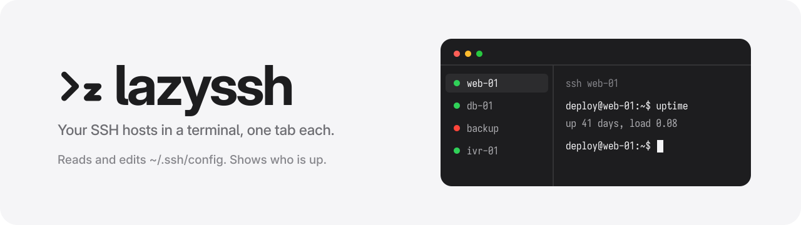

<p align="center"></p>

A terminal app for your SSH hosts. It reads and edits `~/.ssh/config` directly, shows which hosts are up, and opens each connection in its own tab. Built for Linux, with a Windows build too.

- [Install](#install)
- [Update](#update)
- [Manual install](#manual-install)
- [Test](#test)
- [Docs](#docs)
- [License](#license)

## Install

```
curl -fsSL https://raw.githubusercontent.com/DrianeDiojanPerez/lazyssh/refs/heads/master/install.sh | bash
```

It downloads the newest release for your system and puts it in `/usr/local/bin/lazyssh`, asking for your sudo password if it needs to. Then run `lazyssh`.

## Update

```
lazyssh --update
```

It runs the installer again, which sees the version you have and replaces it with the newest one. `lazyssh --version` prints the one you have.

## Manual install

1. Download the archive for your system from the [releases page](https://github.com/DrianeDiojanPerez/lazyssh/releases/latest):

   | System | File |
   |---|---|
   | Linux, Intel or AMD | `lazyssh_Linux_x86_64.tar.gz` |
   | Linux, ARM | `lazyssh_Linux_arm64.tar.gz` |
   | Windows | `lazyssh_Windows_x86_64.zip` |

2. Unpack it and put the binary somewhere in your `PATH`:
   ```
   tar -xzf lazyssh_Linux_x86_64.tar.gz
   sudo install -m 755 lazyssh /usr/local/bin/lazyssh
   ```
   On Windows, unzip it and move `lazyssh.exe` to a folder in your `PATH`.

To build it yourself instead, see [Installing](docs/install.md#build-from-source).

## Test

- Run `lazyssh`. Your hosts from `~/.ssh/config` are listed on the left, each with a dot: green when its SSH port answers, red when it doesn't.
- Pick a host and press `Enter`. It connects in a tab inside lazyssh.
- Press `?` for every key.

## Docs

- [How it works](docs/how-it-works.md): the hosts file, backups, reachability, and the built-in terminal
- [Installing](docs/install.md): what the installer does, by hand, or from source
- [Updating](docs/update.md)
- [Keys](docs/keys.md): every key in the list and in a session
- [Copy and paste](docs/copy-and-paste.md): copying from a remote nvim to your clipboard, and pasting in
- [Settings and themes](docs/settings.md)
- [Troubleshooting](docs/troubleshooting.md)
- [Uninstall](docs/uninstall.md)
- [Releasing](docs/releasing.md)

## License

MIT. See [LICENSE](LICENSE).
